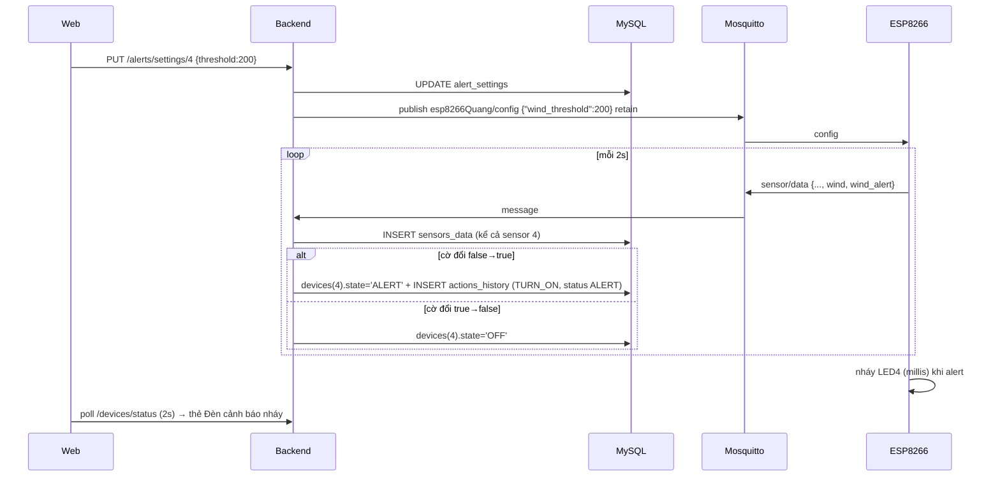

# PLAN – Cảnh báo bằng LED thứ 4 (đề lẻ: gió, đề chẵn: ánh sáng)

Trạng thái: **CHỈ LÀ PLAN, chưa sửa code.** Đã đọc: toàn bộ `server/*` (server.js, config/db.js, controllers/*, services/*, database/schema.sql), `web/src/App.jsx`, `context/DataContext.jsx`, `pages/Dashboard.jsx`, `pages/DeviceHistory.jsx`, `components/Sidebar.jsx`, `constants/colors.js`, `index.css`, `vite.config.js`, README, `mosquitto.conf`, sketch ESP8266. `SensorHistory.jsx` chỉ đọc 300 dòng đầu + grep phần còn lại; `Header.jsx`, `Profile.jsx`, `main.jsx`, SRS-V2.docx/pdf, Sequence/*.jpg **chưa đọc**.

---

## 0. Trả lời nhanh 3 câu hỏi

| Câu hỏi | Trả lời |
|---|---|
| Thêm cảm biến gió HW gửi random → lưu DB: có phải sửa code Arduino? | **Có.** Sketch hiện tại chỉ gửi `temp, hum, light, is_bright`. Phải thêm field `wind` vào payload (`random(0,501)`, dải 0–500). Backend không thể tự có dữ liệu "HW gửi". Ngoài ra phải thêm LED cảnh báo + nhận ngưỡng (xem §3). |
| Có cần thêm bảng? | **Có đúng 1 bảng mới: `alert_settings`** (lưu ngưỡng, sửa được lúc chạy, sống qua restart). **Không** cần bảng mới cho: dữ liệu gió (dùng `sensors` + `sensors_data`, thêm 1 dòng seed `sensor_id=4`), LED cảnh báo (dùng `devices`, thêm 1 dòng seed `id=4`), lịch sử cảnh báo (dùng `actions_history`), biểu đồ tháng (query `GROUP BY` trên `actions_history`). |
| Nháy đèn trực tiếp? | LED nháy **ngay trên ESP** (non-blocking `millis()`), không chờ backend. Backend chỉ ghi nhận + UI nháy theo `devices.state`. |

Đề lẻ và đề chẵn **dùng chung hạ tầng** (LED4, `alert_settings`, dòng lịch sử `status='ALERT'`, trang thống kê). Khác nhau chỉ ở nguồn kích hoạt: lẻ = `wind > 200`, chẵn = `light > x`. Làm Phần A (chung) trước, rồi Phần B (lẻ) và/hoặc Phần C (chẵn).

---

## 1. Hiện trạng đã xác minh trong code (ảnh hưởng thiết kế)

1. `schema.sql` chạy lại **mỗi lần khởi động** qua `initDatabase()` (`multipleStatements`). `CREATE TABLE IF NOT EXISTS` + seed `ON DUPLICATE KEY UPDATE` ⇒ thêm bảng/seed mới **áp dụng được lên DB đang có** mà không cần ALTER. Không có migration ALTER ⇒ **tránh thêm cột vào bảng cũ** (MySQL 8 không có `ADD COLUMN IF NOT EXISTS`).
2. `mqttService.js`: handler sensor `INSERT` cứng 3 dòng `(1,temp),(2,hum),(3,light)`. Không có `wind`.
3. `deviceController.controlDevice`: `mqttCmd` chỉ map id 1–3; id khác → `mqttCmd=''` → `sent=false` → ghi `FAILED` + trả 500. ⇒ Device 4 **phải bị chặn sớm**, nếu không bấm nhầm sẽ sinh log FAILED rác.
4. `DeviceHistory.jsx`:
   - `renderActionBadge`: **không sửa**. Dòng cảnh báo dùng `action='TURN_ON'` nên hiện badge "ON" sẵn có. Cảnh báo chỉ xuất hiện ở cột **Trạng thái**.
   - `renderStatusBadge`: mọi status không SUCCESS/PENDING đều hiện **"Thất bại"** ⇒ `ALERT` hiển thị sai.
   - Cột "Người thực hiện" hard-code `'Đặng Xuân Quang'` cho mọi dòng.
5. `getActionsHistory` đã lọc generic `ah.status = ?` ⇒ lọc `status=ALERT` **chạy được không cần sửa backend**; chỉ thiếu option ở FE.
6. `App.jsx` mount **tất cả** trang cùng lúc, ẩn bằng CSS (`hidden`) ⇒ trang mới fetch lúc mount sẽ cũ. Cần prop `isActive` để refetch khi chuyển tab.
7. Dashboard: `devices` poll mỗi 2s (`/devices/status`) ⇒ UI nháy trễ tối đa ~2s so với LED thật. Chấp nhận được. README nói WebSocket nhưng `server.js` **không có `ws`** – không dựa vào WS.
8. Dashboard grid thiết bị `md:grid-cols-3`, thẻ cảm biến `md:grid-cols-3` – cần đổi sang 4 cột.
9. `getSensorHistory` nhánh chart (`deviceId`/`chart=true`) `GROUP BY time` với `time` = `HH:i:s` (không có ngày) – bug có sẵn, không thuộc scope; chỉ thêm cột `wind`.
10. `sensorSimulator.js` **không được require ở đâu** → không cần sửa.
11. Ánh sáng: ESP gửi `light = map(rawAO, 0, 1023, 0, 100)` bị **ngược chiều**. Nguyên nhân phần cứng: module quang trở (LDR) mắc cầu phân áp khiến khi **chiếu sáng**, điện trở LDR giảm → điện áp chân AO tụt về 0V (`rawAO` nhỏ); khi **che tối**, điện áp AO tăng lên 3.3V (`rawAO` lớn). Do map `0..1023` sang `0..100` nên sáng lại ra số nhỏ, tối lại ra số lớn. Phải sửa trong sketch thành `map(rawAO, 0, 1023, 100, 0)` để đúng thực tế (càng sáng giá trị càng cao). Đồng thời trên `Dashboard.jsx` cần bỏ `reversed={true}` ở trục Y `light` và bỏ `baseValue={lightDomain[1]}` (vốn là code chắp vá trước đây).

---

## 2. Quyết định thiết kế

| # | Quyết định | Lý do / đánh đổi |
|---|---|---|
| D1 | **ESP tự so ngưỡng** và báo cờ `wind_alert` / `light_alert` trong payload; backend **không so lại** | Một nơi quyết định ⇒ không lệch giữa LED thật và DB/UI. Backend chỉ bắt cạnh lên/xuống của cờ. |
| D2 | Ngưỡng nguồn sự thật = DB `alert_settings`; đẩy xuống ESP qua topic mới `esp8266Quang/config`, **retained** + publish lại mỗi lần backend (re)connect MQTT | ESP khởi động sau cũng nhận được ngưỡng ngay khi subscribe. Mất kết nối khi PUT vẫn đồng bộ lại sau. ESP có giá trị mặc định (200 / 70) nếu chưa nhận. |
| D3 | Ghi `actions_history` chỉ ở **cạnh lên**: `action='TURN_ON'`, `status='ALERT'`, `user_id=NULL`. Cảnh báo là một **giá trị của cột Trạng thái** (cùng chỗ Thành công/Thất bại), không phải một loại hành động mới. **Không** ghi dòng khi cảnh báo kết thúc | Khớp yêu cầu "bật cảnh báo, lưu lại trạng thái là cảnh báo"; giảm spam. Trạng thái hiện tại nằm ở `devices.state` (`ALERT`/`OFF`). |
| D4 | LED4 là `devices` id=4, `device_type='ALERT_LIGHT'`, **không có công tắc** | "Không bật tắt" theo đề. Backend trả 400 nếu gọi control. |
| D5 | Biểu đồ tháng = `COUNT(*)` các dòng `device_id=4 AND status='ALERT'` theo ngày, đầy đủ mọi ngày trong tháng (bù 0) | Cùng cách chuyển múi giờ `CONVERT_TZ(..., @@session.time_zone, '+07:00')` đã dùng trong repo. |
| D6 | Không thêm cột vào `actions_history` | Tránh ALTER. Hệ quả: nếu làm **cả lẻ lẫn chẵn** trên cùng LED4, không phân biệt được nguồn cảnh báo trong biểu đồ. Cần phân biệt → thêm cột `sensor_id` bằng migration có kiểm tra `information_schema` trong `db.js` (ngoài scope plan này). |

Luồng:



---

## PHẦN A – Hạ tầng chung (làm trước)

### A1. Database – `server/database/schema.sql` (chỉ thêm, không sửa bảng cũ)

```sql
-- 6. Table Alert_Settings (ngưỡng cảnh báo theo cảm biến)
CREATE TABLE IF NOT EXISTS `alert_settings` (
  `sensor_id` INT PRIMARY KEY,
  `threshold` DOUBLE NOT NULL,
  `updated_at` TIMESTAMP DEFAULT CURRENT_TIMESTAMP ON UPDATE CURRENT_TIMESTAMP,
  CONSTRAINT `fk_alert_settings_sensor` FOREIGN KEY (`sensor_id`) REFERENCES `sensors` (`id`) ON DELETE CASCADE
) ENGINE=InnoDB DEFAULT CHARSET=utf8mb4 COLLATE=utf8mb4_unicode_ci;

-- Seed devices: thêm LED cảnh báo (state không bị ghi đè khi chạy lại vì chỉ UPDATE name)
INSERT INTO `devices` (`id`, `name`, `device_type`, `pin`, `state`) VALUES
(4, 'Đèn cảnh báo', 'ALERT_LIGHT', 'IO15', 'OFF')
ON DUPLICATE KEY UPDATE `name` = VALUES(`name`);
```

Seed `alert_settings` phải đặt **sau** seed `sensors`, và **không ghi đè** giá trị người dùng đã chỉnh:

```sql
-- đề lẻ
INSERT INTO `alert_settings` (`sensor_id`, `threshold`) VALUES (4, 200)
ON DUPLICATE KEY UPDATE `sensor_id` = `sensor_id`;
-- đề chẵn
INSERT INTO `alert_settings` (`sensor_id`, `threshold`) VALUES (3, 70)
ON DUPLICATE KEY UPDATE `sensor_id` = `sensor_id`;
```

(Mỗi đề chỉ seed dòng của mình.)

Kiểm tra: restart server 2 lần → `alert_settings` không bị reset; đổi ngưỡng bằng tay rồi restart vẫn giữ.

### A2. Backend

**Mới `server/services/alertService.js`** (chỉ DB, không require mqttService → tránh vòng phụ thuộc)
- `ALERT_DEVICE_ID = 4`
- `getSettings()`: join `alert_settings` ⨝ `sensors` → `[{sensor_id, name, unit, threshold, updated_at}]`
- `updateThreshold(sensorId, threshold)`: `UPDATE`; trả số dòng ảnh hưởng (0 ⇒ 404)
- `onAlertFlag(flag)`: bắt cạnh.
  - Biến `prev = null`; lần đầu đọc `devices.state` của id 4 để khởi tạo (tránh log trùng sau restart khi đang cảnh báo).
  - `flag === prev` → return.
  - Cạnh lên: `UPDATE devices SET state='ALERT'` + `INSERT actions_history (device_id,user_id,action,status,time) VALUES (4,NULL,'TURN_ON','ALERT',NOW())`.
  - Cạnh xuống: `UPDATE devices SET state='OFF'`.
- `getMonthlyStats(yyyyMM)`:
  ```sql
  SELECT DATE_FORMAT(CONVERT_TZ(time, @@session.time_zone, '+07:00'), '%Y-%m-%d') AS day, COUNT(*) AS count
  FROM actions_history
  WHERE device_id = 4 AND status = 'ALERT'
    AND DATE_FORMAT(CONVERT_TZ(time, @@session.time_zone, '+07:00'), '%Y-%m') = ?
  GROUP BY day
  ```
  Bù 0 cho các ngày thiếu trong JS (số ngày = `new Date(y, m, 0).getDate()`). Không sargable nhưng bảng nhỏ; nếu lớn thì đổi sang `time >= ? AND time < ?` với biên đã quy đổi múi giờ.

**Mới `server/controllers/alertController.js`**
- `GET /api/v1/alerts/settings`
- `PUT /api/v1/alerts/settings/:sensorId` body `{threshold}`: validate `Number.isFinite`, `>= 0`; gió ≤ 500, ánh sáng ≤ 100 (chặn theo `sensorId`). Lưu DB → `publishAlertConfig()`. Trả `{status, data:{sensor_id, threshold}}`. Broker down: vẫn lưu, trả `synced:false` (sẽ đồng bộ lúc MQTT connect).
- `GET /api/v1/alerts/stats?month=YYYY-MM`: regex `^\d{4}-(0[1-9]|1[0-2])$`, mặc định tháng hiện tại giờ +07. Response:
  ```json
  {"status":"success","data":{"month":"2026-10","total":37,"days":[{"date":"2026-10-01","count":0}]}}
  ```

**`server/server.js`**: đăng ký 3 route trên.

**`server/services/mqttService.js`**
- Thêm `topicDeviceConfig = process.env.MQTT_TOPIC_CONFIG || 'esp8266Quang/config'`.
- `publishAlertConfig()`: đọc `alertService.getSettings()`, build `{"wind_threshold":200,"light_threshold":70}` (khóa theo `sensor_id`: 4→`wind_threshold`, 3→`light_threshold`), `publish(topic, payload, {retain:true, qos:1})`. Export.
- Gọi `publishAlertConfig()` trong handler `connect`.
- Handler sensor: parse `wind`, cờ; INSERT động:
  ```js
  const rows = [[1, temp], [2, hum], [3, light]];
  if (wind !== null) rows.push([4, wind]);
  await pool.query(
    'INSERT INTO sensors_data (sensor_id, value, created_at) VALUES ' + rows.map(() => '(?, ?, NOW())').join(', '),
    rows.flat()
  );
  await onAlertFlag(alertFlag);   // chỉ gọi khi payload có cờ
  ```
- `latestSensorValues` thêm `wind`.

**`server/controllers/deviceController.js`**
- `controlDevice`: ngay sau khi lấy `device`, `if (device.device_type === 'ALERT_LIGHT') return res.status(400).json({status:'error', message:'Đèn cảnh báo không thể điều khiển thủ công'})` – **trước** mọi UPDATE/INSERT.
- `getActionsHistory` SELECT: `COALESCE(u.username,'admin')` → `CASE WHEN ah.user_id IS NULL THEN 'system' ELSE u.username END AS user_name`. (Các dòng LOADING cũ đều `user_id=1` nên không đổi.)

**`.env`/README**: thêm `MQTT_TOPIC_CONFIG=esp8266Quang/config`. (`server/.env` hiện tồn tại; không in nội dung.)

### A3. Frontend chung

**`index.css`**: thêm keyframes + class nháy cho box:
```css
@keyframes alert-blink {
  0%, 100% { border-color: #ef4444; background-color: #fef2f2; box-shadow: 0 0 0 4px rgba(239,68,68,.25); }
  50%      { border-color: #fecaca; background-color: #ffffff; box-shadow: 0 0 0 0 rgba(239,68,68,0); }
}
.alert-blink { animation: alert-blink 0.5s ease-in-out infinite; }
```
Nên bọc `@media (prefers-reduced-motion: reduce)` giảm tốc độ nháy (accessibility).

**`Dashboard.jsx` – khối thiết bị**
- Grid `md:grid-cols-3` → `md:grid-cols-2 lg:grid-cols-4`.
- Với `device.device_type === 'ALERT_LIGHT'`: render nhánh riêng – **không có `<button>` công tắc**; `state==='ALERT'` → class `alert-blink border-2`, nhãn "ĐANG CẢNH BÁO", icon cảnh báo (lucide-react đã có sẵn: `TriangleAlert`); ngược lại nhãn "BÌNH THƯỜNG". Thẻ không dùng `handleToggleDevice`.
- `/devices/status` hiện chọn các cột `id,name,device_type,pin,state,updated_at` ⇒ `device_type` đã có sẵn trong response.

**`DeviceHistory.jsx`**
- `renderActionBadge`: **giữ nguyên** (dòng cảnh báo hiện "ON" như hiện tại).
- `renderStatusBadge`: thêm nhánh `ALERT` → badge "Cảnh báo" (rose-50/rose-600, chấm `animate-ping`), đặt cùng chỗ với "Thành công"/"Thất bại"/"Đang xử lý".
- Select "Trạng thái": thêm `<option value="ALERT">Cảnh báo</option>` (cạnh Thành công / Đang xử lý / Thất bại). **Không** thêm option vào select "Hành động".
- Cột người thực hiện: `row.status === 'ALERT' ? 'Hệ thống' : 'Đặng Xuân Quang'`.
- Dropdown thiết bị lấy từ `devices` context nên tự có "Đèn cảnh báo"; fallback hard-code (Đèn 1-3) thêm option 4.
- Lọc theo cảnh báo (yêu cầu đề chẵn) = chọn Trạng thái = Cảnh báo. Cân nhắc nút nhanh "Chỉ cảnh báo" set `{status:'ALERT'}` + search.
- `STATUS_COLORS` trong `constants/colors.js`: thêm `alert` (rose) nếu muốn dùng chung màu.

**`DataContext.jsx`**: thêm state `alertSettings` + `fetchAlertSettings`, và (nếu muốn cache như các trang khác) `alertStats`. Đơn giản hơn: để trang tự fetch bằng axios như `Dashboard.jsx` đang làm.

**Trang mới `web/src/pages/AlertStats.jsx`** ("Thống kê cảnh báo")
- `<input type="month">` + nút tháng trước/sau; mặc định tháng hiện tại.
- Recharts `BarChart` (recharts đã là dependency): X = ngày (1…31), Y = số cảnh báo/ngày, `allowDecimals={false}`, Tooltip, tổng tháng ở tiêu đề.
- Card "Cài đặt ngưỡng": input số + nút Lưu → `PUT /alerts/settings/:id`; hiển thị ngưỡng hiện tại, toast thành công / `synced:false`.
- Props `isActive`: `useEffect` refetch khi `isActive` đổi sang `true` hoặc `month` đổi.
- Trạng thái loading/empty/error như các trang khác.

**`App.jsx`**: thêm khối `<div className={... activeTab === '/alert-stats' ...}><AlertStats isActive={activeTab === '/alert-stats'} /></div>`.
**`Sidebar.jsx`**: thêm `{ path: '/alert-stats', label: 'Thống kê cảnh báo' }`.
**`constants/colors.js`**: thêm `ALERT_COLORS` (rose) và `SENSOR_COLORS.wind` (cho Phần B).

### A4. Phần cứng chung (sketch ESP8266)

- Thêm LED4: `#define LED_ALERT 15 // IO15 (D8, GPIO15)` + `pinMode(LED_ALERT, OUTPUT); digitalWrite(LED_ALERT, LOW);`.
  - Chân IO15 do bạn chỉ định. D5/D6/D7 (IO14/12/13) và D2/D1/A0 (IO4/IO5/A0) đã dùng, không trùng.
  - Lưu ý phần cứng: GPIO15 là strapping pin, **phải ở mức LOW lúc boot**. Nối LED anode → điện trở (220–330Ω) → IO15, cathode → GND thì an toàn (kéo về LOW). **Không** nối kiểu LED active-low (anode lên 3V3) hoặc kéo IO15 lên HIGH, nếu không ESP không boot.
  - Seed DB dùng `pin = 'IO15'` cho khớp cách gọi của bạn (các thiết bị cũ đang ghi 'D1','D2','D7').
- Khai báo topic: `const char* mqtt_topic_config = "esp8266Quang/config";`
- `reconnect()`: sau `client.subscribe(mqtt_topic_control)` thêm `client.subscribe(mqtt_topic_config)`.
- `callback()`: **phải** rẽ nhánh theo `topic` ngay đầu hàm (hiện callback bỏ qua `topic`, coi mọi message là lệnh điều khiển và cuối hàm bật `needSendResponse`):
  ```cpp
  if (strcmp(topic, mqtt_topic_config) == 0) {
    windThreshold  = readIntField(message, "\"wind_threshold\":",  windThreshold);
    lightThreshold = readIntField(message, "\"light_threshold\":", lightThreshold);
    return;   // không phát device_response
  }
  ```
  ```cpp
  int readIntField(const String& msg, const char* key, int fallback) {
    int i = msg.indexOf(key);
    if (i < 0) return fallback;
    return msg.substring(i + strlen(key)).toInt();
  }
  ```
- Nháy không chặn (gọi mỗi vòng `loop()`, **ngoài** khối 2s):
  ```cpp
  void updateAlertLed(bool active) {
    static unsigned long lastBlink = 0;
    static bool level = false;
    unsigned long now = millis();
    if (active) {
      if (now - lastBlink >= 250) { lastBlink = now; level = !level; digitalWrite(LED_ALERT, level); }
    } else if (level) { level = false; digitalWrite(LED_ALERT, LOW); }
  }
  ```
- Giới hạn đã biết: `reconnect()` có vòng `while (!client.connected())` chặn ⇒ khi mất broker LED đứng yên ở trạng thái cuối. Khắc phục rẻ: gọi `updateAlertLed(...)` trong vòng `delay(100)/yield()` của `reconnect()`.
- Payload: hiện chuỗi kết thúc bằng `"}"` cố định ⇒ phải chèn field mới **trước** dấu đóng.

---

## PHẦN B – Đề lẻ: cảm biến tốc độ gió + cảnh báo > 200

### B1. DB
```sql
-- thêm vào seed sensors (id=4). pin = 'SIM' vì giá trị random từ firmware
INSERT INTO `sensors` (`id`, `name`, `sensor_type`, `unit`, `pin`, `status`) VALUES
(4, 'Tốc độ gió', 'WIND', 'km/h', 'SIM', 'ACTIVE')
ON DUPLICATE KEY UPDATE `name` = VALUES(`name`);
```
(Đơn vị `km/h` là giả định của plan; đổi `m/s` nếu đề yêu cầu – lúc đó ngưỡng 200 phi thực tế nhưng không ảnh hưởng logic.)
Seed `alert_settings (4, 200)` như A1.

### B2. Sketch
```cpp
int windThreshold = 200;
bool windAlert = false;
// trong khối đọc cảm biến mỗi 2s:
int wind = random(0, 501);              // 0..500 ⇒ 60% mẫu > 200 (300/501)
windAlert = wind > windThreshold;        // strict ">" theo "vượt ngưỡng"
// payload thêm: ,"wind":<wind>,"wind_alert":true|false
// cuối loop(): updateAlertLed(windAlert);
```
Lưu ý khối lượng: với ngưỡng 200 trên dải 0–500, mẫu độc lập mỗi 2s có 60% > 200 ⇒ xác suất cạnh lên mỗi mẫu = 0,4 × 0,6 = 0,24 ⇒ **~10 nghìn dòng `status='ALERT'`/ngày** và LED gần như nháy liên tục. Nếu muốn demo biểu đồ rõ hơn: random-walk (`wind += random(-50,51)` kẹp 0..500) để cảnh báo kéo dài; vẫn là "random" từ HW. Chốt cách random trước khi nạp.

### B3. Backend
- `mqttService`: `wind = data.wind`, `alertFlag = data.wind_alert === true || data.wind_alert === 'true'`; INSERT sensor 4; `onAlertFlag`.
- `sensorController.getRealtimeSensor`: thêm subselect `(SELECT value FROM sensors_data WHERE sensor_id = 4 ORDER BY created_at DESC, id DESC LIMIT 1) as wind` và trả `wind` trong `data` (cả nhánh fallback `getLatestValues()`).
- `sensorController` nhánh chart: thêm `MAX(CASE WHEN s.sensor_type = 'WIND' OR s.id = 4 THEN sd.value END) as wind`, map `wind: r.wind || 0`.
- Lịch sử cảm biến: `sensor_id=4`/`sensor_type=WIND` lọc được sẵn.

### B4. Frontend
- `DataContext`: `sensors.wind` (mặc định 0), `chartData` point thêm `wind`.
- `Dashboard.jsx`: grid thẻ cảm biến `md:grid-cols-3` → `md:grid-cols-2 lg:grid-cols-4`; thêm thẻ "Tốc độ gió" (đơn vị, thanh tiến trình theo 500, chuyển đỏ + chữ "VƯỢT NGƯỠNG" khi `wind > threshold`); thêm `Area` + `YAxis` ẩn cho `wind` trong biểu đồ xu hướng, `SENSOR_COLORS.wind`.
- `SensorHistory.jsx`: thêm option `WIND` ("Tốc độ gió (km/h)") ở dropdown (dòng ~366-370), nhánh `handleSearch` (`sensor_type='WIND'`, `sensor_id='4'`), nhãn input ("Giá trị (Tốc độ gió)"), và `case 'WIND'` trong `renderBadge`.

### B5. Acceptance (đề lẻ)
1. Sau khi nạp sketch, `sensors_data` có thêm dòng `sensor_id=4` mỗi ~2s, giá trị 0–500.
2. Lịch sử cảm biến lọc được "Tốc độ gió"; Dashboard hiển thị thẻ + đường gió.
3. Khi `wind > 200`: LED4 vật lý nháy ~4 Hz ngay trong chu kỳ đọc đó; hết vượt thì tắt.
4. Cùng lúc: thẻ "Đèn cảnh báo" trên Dashboard nháy đỏ (trễ ≤ ~2s), không có công tắc.
5. `actions_history` có dòng `device_id=4, action='TURN_ON', status='ALERT', user_id NULL` đúng **một dòng mỗi lần vượt ngưỡng** (không lặp mỗi 2s khi đang vượt liên tục).
6. Trang Lịch sử thiết bị: cột Hành động hiện "ON", cột **Trạng thái hiện "Cảnh báo"**; chọn Trạng thái = Cảnh báo chỉ ra đúng các dòng đó (không hiện "Thất bại").
7. Trang Thống kê: biểu đồ cột theo ngày của tháng, tổng khớp `SELECT COUNT(*)`.
8. Đổi ngưỡng trong UI (ví dụ 100) ⇒ DB đổi, ESP áp dụng không cần nạp lại; restart ESP vẫn nhận ngưỡng (retained); restart backend không reset ngưỡng.

---

## PHẦN C – Đề chẵn: ánh sáng > x (x chỉnh được) + lọc cảnh báo + biểu đồ tháng

(Đã có LED4/`alert_settings`/trang thống kê/lọc từ Phần A. Chỉ thêm nguồn kích hoạt.)

### C1. DB
Seed `alert_settings (3, 70)` (A1). Ánh sáng có sẵn `sensors.id=3`; **không** thêm cảm biến.

### C2. Sketch
```cpp
int lightThreshold = 70;
bool lightAlert = false;
// trong khối 2s, sau khi tính lightPercent:
lightAlert = lightPercent > lightThreshold;
// payload thêm: ,"light_alert":true|false
// cuối loop(): updateAlertLed(lightAlert);
```
"Setting HW mức x" = ngưỡng đẩy từ UI → `esp8266Quang/config` → biến `lightThreshold` trên ESP (RAM; mất khi reset nhưng nhận lại từ retained message). Không cần EEPROM.

### C3. Backend
- `mqttService`: `alertFlag = data.light_alert === true || data.light_alert === 'true'` thay cho `wind_alert`.
- Validation PUT: `sensorId=3` ⇒ `0 ≤ threshold ≤ 100`.

### C4. Frontend
- Sửa `Dashboard.jsx`: bỏ `reversed={true}` ở `YAxis yAxisId="light"` và bỏ `baseValue={lightDomain[1]}` ở `Area yAxisId="light"` để đồ thị vẽ đúng hướng khi sketch đã được sửa map thuận.
- Thẻ Ánh sáng trên Dashboard: viền/nhãn đỏ khi `light > threshold`.
- Lọc cảnh báo ở Lịch sử thiết bị: như A3 (select Trạng thái = Cảnh báo).
- Biểu đồ tháng + ô cài đặt x: như A3 (`AlertStats.jsx`).

### C5. Acceptance (đề chẵn)
1. Che/chiếu đèn pin để `light` vượt x ⇒ LED4 nháy; hạ xuống ⇒ tắt. (Kiểm tra chiều tăng/giảm của module – xem §1.11.)
2. Đổi x trên UI ⇒ ESP áp dụng ở mẫu kế tiếp (≤2s) – xác nhận bằng Serial Monitor in `lightThreshold`.
3. Lịch sử thiết bị: lọc Trạng thái = Cảnh báo ra đúng các dòng `status='ALERT'`; Reset trả về đầy đủ.
4. Biểu đồ tháng hiển thị số cảnh báo/ngày; chuyển tháng hoạt động; tháng không có dữ liệu vẫn vẽ trục 0.
5. Mục 4–5 của B5 (thẻ nháy, một dòng/lần).

---

## 3. Kiểm thử không cần phần cứng

Broker `mosquitto.conf`: cổng 6868, `allow_anonymous true` (hiện **không bắt xác thực** – chỉ chấp nhận trong mạng LAN dev; cũng áp dụng cho topic config mới, ai cùng mạng đều đổi được ngưỡng; đừng expose ra Internet).

```powershell
# giả lập ESP – cạnh lên (đề lẻ)
mosquitto_pub -h localhost -p 6868 -u DangXuanQuang -P B23DCCN686 -t esp8266Quang/sensor/data -m '{"temp":28,"hum":70,"light":50,"is_bright":true,"wind":250,"wind_alert":true}'
# lặp lại cùng cờ (khác wind để qua bộ chống trùng 1.5s) ⇒ KHÔNG thêm dòng status ALERT
# cạnh xuống
mosquitto_pub ... -m '{"temp":28,"hum":70,"light":50,"is_bright":true,"wind":120,"wind_alert":false}'
# xem ngưỡng retained
mosquitto_sub -h localhost -p 6868 -u DangXuanQuang -P B23DCCN686 -t esp8266Quang/config -C 1
```
```powershell
curl http://localhost:5000/api/v1/devices/status
curl "http://localhost:5000/api/v1/actions/history?status=ALERT"
curl "http://localhost:5000/api/v1/alerts/stats?month=2026-10"
curl -X PUT http://localhost:5000/api/v1/alerts/settings/4 -H "Content-Type: application/json" -d "{\"threshold\":150}"
curl -X POST http://localhost:5000/api/v1/devices/4/control -H "Content-Type: application/json" -d "{\"action\":\"TURN_ON\"}"   # kỳ vọng 400, không có dòng history mới
```
Regression: bật/tắt Đèn 1–3 từ Dashboard vẫn chạy (LOADING → SUCCESS), Lịch sử cảm biến vẫn phân trang, `restart server` 2 lần không nhân đôi seed / không reset ngưỡng / không đổi `devices.state` của Đèn 4.
UI: chạy `npm run dev`, mở Dashboard + Lịch sử thiết bị + Thống kê, quan sát bằng trình duyệt (nháy, badge, biểu đồ).

---

## 4. Danh sách file thay đổi

| File | Việc | A | B | C |
|---|---|:-:|:-:|:-:|
| `server/database/schema.sql` | bảng `alert_settings`, seed device 4, seed ngưỡng | ✔ | ✔ (sensor 4, ngưỡng 4) | ✔ (ngưỡng 3) |
| `server/services/alertService.js` (mới) | settings, bắt cạnh, thống kê tháng | ✔ | | |
| `server/controllers/alertController.js` (mới) | 3 endpoint | ✔ | | |
| `server/server.js` | route | ✔ | | |
| `server/services/mqttService.js` | topic config, publish retained, parse `wind`/cờ, INSERT động | ✔ | ✔ | ✔ (cờ ánh sáng) |
| `server/controllers/deviceController.js` | chặn control ALERT_LIGHT; `user_name` cho dòng hệ thống | ✔ | | |
| `server/controllers/sensorController.js` | `wind` trong realtime + chart | | ✔ | |
| `server/.env`, `README.md`, `IoT-Smart-Home.postman_collection.json` | env/doc/API mới | ✔ | ✔ | ✔ |
| `web/src/index.css` | `.alert-blink` | ✔ | | |
| `web/src/constants/colors.js` | `ALERT_COLORS`, `SENSOR_COLORS.wind` | ✔ | ✔ | |
| `web/src/pages/Dashboard.jsx` | thẻ LED4 nháy không công tắc; grid 4 cột; thẻ gió + đường gió | ✔ | ✔ | ✔ (highlight) |
| `web/src/pages/DeviceHistory.jsx` | badge ALERT, option lọc, người thực hiện | ✔ | | |
| `web/src/pages/SensorHistory.jsx` | option/badge WIND | | ✔ | |
| `web/src/pages/AlertStats.jsx` (mới) | biểu đồ tháng + cài đặt ngưỡng | ✔ | | |
| `web/src/App.jsx`, `components/Sidebar.jsx` | route/tab mới | ✔ | | |
| `web/src/context/DataContext.jsx` | `wind` trong sensors/chart | | ✔ | |
| Sketch Arduino | LED4, config topic, nháy, `wind`/cờ | ✔ | ✔ | ✔ |

SRS-V2.docx/pdf và `Sequence/*.jpg` mô tả hệ thống cũ – nếu đề yêu cầu cập nhật tài liệu thì thêm UC "Cảnh báo" & "Thống kê cảnh báo" (ngoài scope code).

---

## 5. Rủi ro / điểm cần chốt trước khi code

1. **Làm đề nào?** Plan hỗ trợ cả hai, nhưng LED4 dùng chung ⇒ làm cả hai cùng lúc sẽ trộn nguồn cảnh báo (xem D6). Cần chốt: chỉ lẻ, chỉ chẵn, hay cả hai.
2. **Đã chốt lỗi ngược sáng**: Sửa sketch map thành `map(rawAO, 0, 1023, 100, 0)` (sáng = giá trị cao, tối = giá trị thấp). Khi đó đề chẵn `light > x` đúng nghĩa là: **chiếu sáng vượt mức x thì cảnh báo**.
3. **Chân LED4**: đã chốt IO15 (xem A4, cần LED nối cathode xuống GND để boot được).
4. **Đơn vị gió** (km/h giả định); dải random đã chốt 0–500.
5. **Spam cảnh báo** với random độc lập (B2) – chọn random-walk nếu muốn demo biểu đồ rõ.
6. **ESP chết khi đang cảnh báo** ⇒ `devices.state` kẹt `ALERT`, thẻ nháy mãi. Nếu cần: timer backend, 10s không có sensor message ⇒ ép `OFF`. Chưa đưa vào plan chính.
7. Múi giờ: mọi truy vấn thống kê dùng cùng mẫu `CONVERT_TZ(.., @@session.time_zone, '+07:00')` như code cũ; kiểm tra ranh giới 00:00 khi test.
